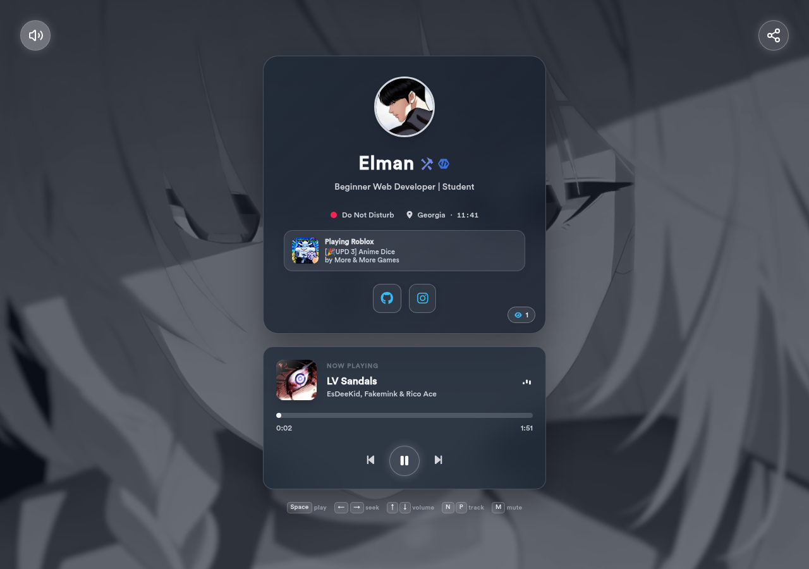
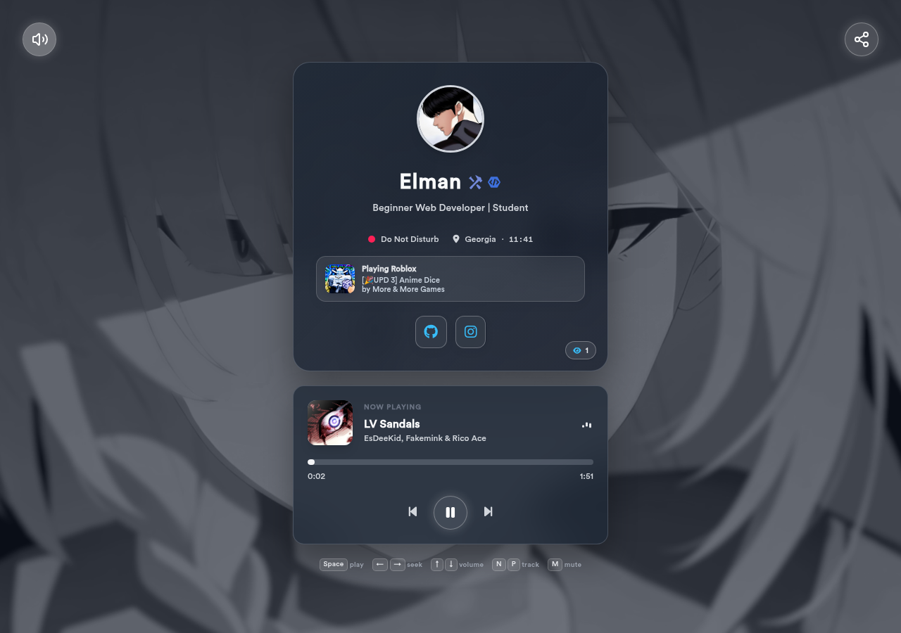
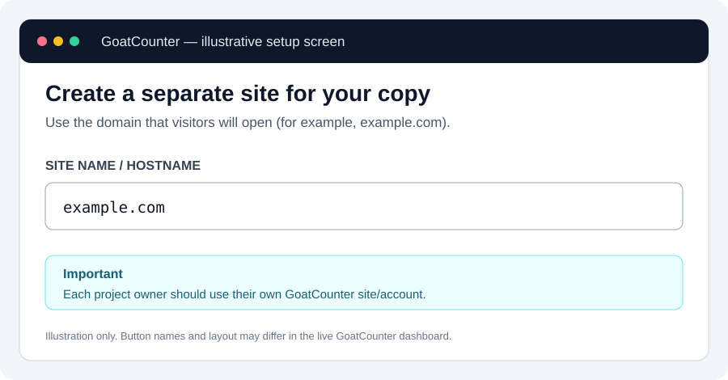
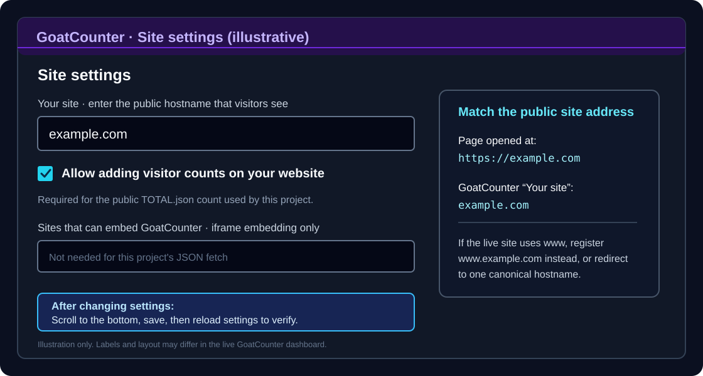
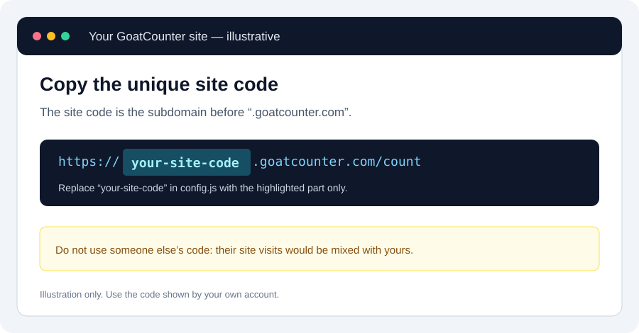
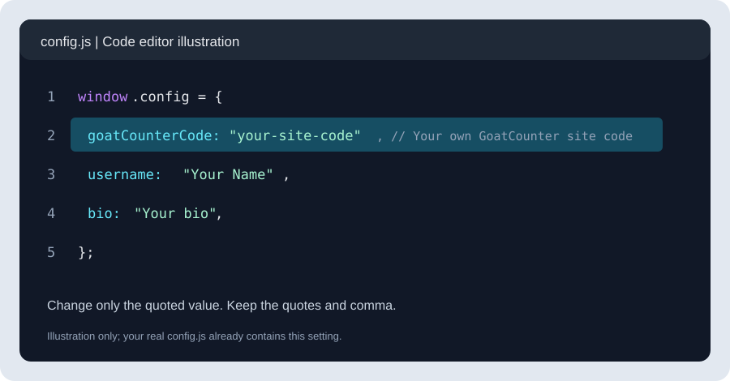
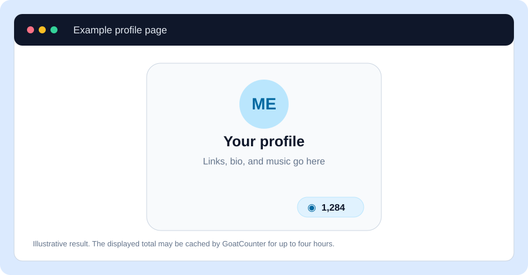

# Bio Portal

A lightweight personal bio-link page built with HTML, Tailwind CSS, and vanilla JavaScript. It pairs a glass-style profile card with social links, live Discord presence, a visitor counter, a video background, and a multi-track music player.





## NOTE
If you cant understand what to do ask it to an AI model thats the easy way to customize your Bio Portal

## Features

- Profile name, avatar, bio, badges, location, and social links configured from a single file
- Real-time Discord status through the [Lanyard API](https://github.com/Phineas/lanyard)
- Per-site visitor counting through GoatCounter, configured by one site code
- Play, pause, previous, next, seek, and volume controls for local audio tracks
- Light and dark theme styling controlled through `theme.js`

## GoatCounter Visitor Counter: Complete Setup and Troubleshooting Guide

This project uses [GoatCounter](https://www.goatcounter.com/) for two related tasks: it records page visits and displays a public total in the eye badge. Each person who publishes a copy of this project should configure **their own GoatCounter site**. That keeps their data separate and lets them choose their own domain and account.

GoatCounter is an external analytics service. The browser sends visits to GoatCounter, and the project reads GoatCounter's public total-count endpoint. This is not the same thing as the optional local NeDB database described below: the public counter does not read or write `data/views.db`, and static hosts do not need a database server or a Netlify Function for it.

The setup has three parts: create a GoatCounter site, allow its public counter to be embedded, and set its site code in `config.js`. The images in this guide are illustrations; GoatCounter's live dashboard layout can change.

### Quick setup checklist

- [ ] Create a GoatCounter site for the canonical public domain.
- [ ] In that site's settings, set **Your site** to the domain serving this page.
- [ ] Enable **Allow adding visitor counts on your website**.
- [ ] Save the settings at the bottom of the page and verify they remain saved after reloading.
- [ ] Copy the site's code into `config.js` as `goatCounterCode`.
- [ ] Deploy the updated files, then test on the real public domain.
- [ ] If the counter fails, identify whether the browser reports CORS, 404/403, or `ERR_BLOCKED_BY_CLIENT`; these have different causes.

### What happens when someone visits

1. `index.html` loads `config.js` and the page scripts.
2. `database.js` reads `window.config.goatCounterCode`.
3. On a published domain, it loads GoatCounter's `count.js` tracker. The tracker sends a page visit to `https://<site-code>.goatcounter.com/count`.
4. The project requests `https://<site-code>.goatcounter.com/counter/TOTAL.json` and displays the returned `count` value in the eye badge.
5. On local development addresses such as `localhost`, this project deliberately skips both requests and displays `—`.

The code is public by design: it identifies the GoatCounter site endpoint. It is not an API key or password. Never put a password, secret token, or private credential in `config.js`.

### Step 1: Create a site for your domain

1. Sign in or create an account at [GoatCounter](https://www.goatcounter.com/).
2. Create a site for this copy of the profile. Enter the **canonical hostname visitors actually use**, for example `example.com` or `www.example.com`.
3. Choose one canonical address if both the root domain and `www` work. Redirect the alternate address to the canonical one, or register the domain users actually visit in GoatCounter. A mismatch can prevent the counter response from being allowed on your page.
4. Finish creating the site. GoatCounter will provide an endpoint similar to `https://your-code.goatcounter.com/count`.

For this project, if the browser address is `https://elmanrare.dev`, set **Your site** to `elmanrare.dev` (without `https://` and without a trailing slash) so the dashboard links back to the right page. If the browser address is `https://www.example.com`, use `www.example.com`.



### Step 2: Configure the site settings, including CORS/public counts

Open the settings for the specific GoatCounter site you created. In **Site settings**, check the following fields:

| GoatCounter setting | What to enter or select | Why it matters |
| --- | --- | --- |
| **Your site** | The hostname or URL for your public site, such as `elmanrare.dev`. | GoatCounter uses this to link to your site from its overview. It is not an iframe allowlist or an API credential. |
| **Allow adding visitor counts on your website** | Turn it on. | Allows public visitor-count responses. GoatCounter disables this by default to avoid exposing totals unintentionally. The project needs this for its badge. |
| **Sites that can embed GoatCounter** | Leave blank for this project's current JSON counter. | This is for embedding GoatCounter itself in a frame/iframe; it is not the allowed-origin field for the visitor-count badge. |
| **Custom domain** | Optional; normally leave blank. | This is a vanity domain for GoatCounter endpoints and requires DNS setup. It is not required to connect your own website domain. |

After changing a setting, scroll to the bottom and press the page's save button (for example, **Save settings**). Then reload the settings page and verify the visitor-count checkbox is still selected. A checkbox that appears selected before saving does not prove the change was persisted.



**Important:** the **Sites that can embed GoatCounter** field is specifically about iframe embedding. This project makes a JSON `fetch()` request; adding `elmanrare.dev` to that iframe field is not the fix for a CORS error from `counter/TOTAL.json`. GoatCounter documents the public-counter toggle as the requirement for displaying visitor counts. See the official [visitor counter guide](https://www.goatcounter.com/help/visitor-counter) and [iframe embedding guide](https://www.goatcounter.com/help/frame).

### Step 3: Copy the site code

The endpoint GoatCounter provides looks like this:

```text
https://your-site-code.goatcounter.com/count
```

Copy only `your-site-code`, the portion between `https://` and `.goatcounter.com`. Do not copy `/count`, the full URL, or your account email. In this example, the code is `your-site-code`.



### Step 4: Put the code in `config.js`

Open `config.js` and set `goatCounterCode` to the code for **your own** GoatCounter site:

```js
window.config = {
  username: "Your Name",
  goatCounterCode: "your-site-code",
  // Keep the rest of your profile configuration here.
};
```

For example, the existing `elmanrare` code generates these requests:

```text
https://elmanrare.goatcounter.com/count
https://elmanrare.goatcounter.com/counter/TOTAL.json
```

The first URL records visits; the second returns the site's public total. `database.js` builds these URLs from `goatCounterCode`. You do not need to paste a second tracker snippet into `index.html`, create a database, or add a Netlify Function. Do not edit the code in `database.js` just to change the site code.



### Step 5: Deploy and verify

Deploy the project to the canonical domain configured in GoatCounter. For a Netlify deploy, make sure the deployed output contains the updated `config.js` and `database.js`. Changing a GoatCounter dashboard setting does not require a site rebuild, but changing the project code does.

Verify the setup in this order:

1. Open the production website at the exact registered hostname (including or excluding `www` as configured).
2. Open DevTools → **Network**, reload the page, and filter for `goatcounter` or `counter`.
3. Confirm the tracker request to `gc.zgo.at/count.js` is not blocked and the visit request to your site's `/count` endpoint completes.
4. Confirm the request to `/counter/TOTAL.json` returns a successful response containing a `count` field. GoatCounter may return the count as a formatted string.
5. Confirm the number appears in the eye badge.
6. Check the GoatCounter dashboard for the visit. New activity can take a short time to appear, and the public counter output may be cached for up to four hours.



The public total endpoint can be opened directly for a basic check, replacing the code if necessary:

```text
https://your-site-code.goatcounter.com/counter/TOTAL.json
```

This direct check confirms whether the public total endpoint responds. It does **not** by itself prove that the page's browser is allowed to read the response cross-origin; for that, inspect the Network request from the published website and check its response status and CORS headers.

### Troubleshooting by exact error

#### `Access-Control-Allow-Origin` / CORS error

Example:

```text
Access to fetch at 'https://your-code.goatcounter.com/counter/TOTAL.json'
from origin 'https://example.com' has been blocked by CORS policy
```

The browser reached the GoatCounter counter endpoint, but it did not receive a CORS header that allows the page to read the response. Check these items in order:

1. In GoatCounter, open the settings for the same site code used by `config.js`.
2. Confirm you are checking settings for the GoatCounter site code currently used in `config.js`.
3. Verify **Allow adding visitor counts on your website** is selected.
4. Scroll down and save. Reload the settings page and confirm the checkbox remains selected.
5. Verify `config.js` uses that same site code, not another GoatCounter site code.
6. Open DevTools → Network and inspect the `TOTAL.json` request status and response. Reload the production page after saving and inspect the request again.

The **Your site** field is used for links in the GoatCounter overview; it is not an origin allowlist. The **Sites that can embed GoatCounter** list controls iframe embedding and is not a substitute for the visitor-count setting. If public counts are enabled and saved but the JSON request still has a CORS error, capture the request URL, request `Origin`, response status, and response headers from DevTools → Network and contact GoatCounter support. Do not add `Access-Control-Allow-Origin` headers to Netlify for a response served by GoatCounter; only the GoatCounter endpoint can set its own response headers.

#### `403 Forbidden` or `404 Not Found`

- **403**: check whether public visitor counts are enabled and saved for the GoatCounter site in the URL. Also verify the site code is correct.
- **404**: check for a typo in the site code or URL, and make sure the requested path is the exact `TOTAL` endpoint. `TOTAL` is uppercase.
- Confirm the deployed `config.js` is the one you edited. A stale deployment may still contain an old site code.

#### `net::ERR_BLOCKED_BY_CLIENT`

A browser extension, DNS filter, or built-in tracking protection blocked a GoatCounter resource such as `gc.zgo.at/count.js` or `*.goatcounter.com`. That browser may neither send a visit nor load the public total. Test in a clean browser profile or allow GoatCounter for your site. Site owners cannot force visitors' browsers to allow analytics, and the page should continue to work without the counter.

#### The number does not change immediately

GoatCounter can cache the public counter response for up to four hours. Repeated reloads from the same browser may also be deduplicated by the session settings. Check the dashboard and wait for the public response cache to expire before treating a stale badge as a deployment failure.

#### Localhost shows `—`

This is expected. The project intentionally skips GoatCounter requests on `localhost`, `127.0.0.1`, and other local addresses. GoatCounter ignores local visits by default, so the local preview displays `—` rather than generating expected 403/CORS messages or inflating production analytics. Verify the counter on the deployed domain.

#### It works locally but not on the deployed domain (or vice versa)

The browser origin changes between local development and production. The local site intentionally skips analytics. On production, confirm that the deployed `goatCounterCode` identifies the correct GoatCounter site and that the visitor-count setting is enabled there. The **Your site** field controls the dashboard link to your website.

### Visits, sessions, and pageviews

GoatCounter's session behavior can avoid counting a reload as a brand-new visit. Do not use repeated refreshes as the only test. If you want to change how sessions and visitors are counted, use the site's data-collection/session settings and read GoatCounter's [sessions and visitors documentation](https://www.goatcounter.com/help/sessions). The badge displays the **site total** using the special, case-sensitive path `TOTAL`; it is not a count limited to the current URL.

### Privacy, blockers, and ownership

- Each fork owner should use their own GoatCounter site. Leaving `elmanrare` in a public fork sends that fork's analytics to the `elmanrare` GoatCounter account.
- The site code is not secret, but it identifies where the visits and public total belong.
- Browser blockers can prevent tracking. No frontend code can guarantee a visit is recorded when the visitor's browser refuses the request.
- A GoatCounter custom/vanity domain is optional and requires DNS configuration; GoatCounter notes that it does not reliably avoid ad blockers. Self-hosting is an alternative for operators who want to run the service themselves, but it still cannot override a visitor's browser settings.
- The profile remains usable if GoatCounter is unavailable; only visit analytics and the count badge are affected.

### GoatCounter reference links

- [Getting started and tracker installation](https://www.goatcounter.com/help/start)
- [Visitor counter, public count setting, and JSON response](https://www.goatcounter.com/help/visitor-counter)
- [JavaScript integration settings](https://www.goatcounter.com/help/js)
- [Embedding GoatCounter in an iframe](https://www.goatcounter.com/help/frame)
- [Sessions and visitors](https://www.goatcounter.com/help/sessions)
- [Content Security Policy configuration](https://www.goatcounter.com/help/csp)

## Requirements

- Node.js and npm for rebuilding Tailwind CSS
- A local web server for development, because the page uses JavaScript modules

## Getting Started

### One-click setup on Windows

Install Node.js LTS once, then double-click `Start.bat` in the project folder. It installs the project packages on first run, starts the local site, and opens `http://localhost:5000`. Keep the server window open while using the site. Do not use VS Code Live Server (`localhost:5500`); use the address opened by this launcher.

On macOS or Linux, open a terminal in the project folder and run:

```bash
npm install
npm start
```

Then open `http://localhost:5000`.

### Manual local setup

1. Install dependencies (run this once after cloning):

   ```bash
   npm install
   ```

2. Start the local site:

   ```bash
   npm start
   ```

   Open `http://localhost:5000`. Do not open `index.html` directly or use a separate static server.

3. If you edit Tailwind classes, run `npm run dev` in another terminal to rebuild the stylesheet while editing.

The visible visitor counter uses GoatCounter in local previews and on the deployed site. `db.js` is also included as an optional local NeDB CRUD module; it is not used by the GoatCounter badge.

### Local database CRUD

`nedb-promises` is the embedded database used by the local server. It requires no database service and creates `data/views.db` when first used. Install it with `npm install nedb-promises`. From another CommonJS module, use the database like this:

```js
const db = require("./db");

async function example() {
  const record = await db.create({ name: "Example", active: true });
  const records = await db.read({ active: true });
  const updated = await db.update({ _id: record._id }, { active: false });
  const deletedCount = await db.delete({ _id: record._id });
}
```

The local database files are ignored by Git through `data/*.db` in `.gitignore`.

### Manual Netlify deploy

When Netlify is not connected to the GitHub repository, deploy the static site from the project root with the Netlify CLI. Sign in and link this folder to the existing Netlify site once, then deploy:

```bash
npx netlify-cli login
npx netlify-cli link
npm run deploy:netlify
```

The visitor counter does not need a Netlify Function, Blobs storage, or any host-specific API. The build publishes only the static site files, and the browser sends visits to the GoatCounter site code configured in `config.js`.

## Customization

Most personal settings live in [`config.js`](config.js):

```js
window.config = {
	username: "Your Name",
	goatCounterCode: "your-site-code",
	bio: "Your short bio",
	avatar: "./assets/profilepicture.jpg",
	background: "assets/background.mp4",
	songs: [
		{ audio: "songs/audio.mp3", title: "Song title", artist: "Artist" }
	],
	socials: [
		{
			title: "GitHub",
			url: "https://github.com/your-name",
			icon: "fa-brands fa-github"
		}
	]
};
```

You can add badges using an icon URL or an Iconify icon name. Social icons use Font Awesome classes. Replace the sample media in `assets/` and `songs/` while keeping the paths in `config.js` correct.

### Theme

`theme.js` exposes the following browser API:

```js
themeController.getTheme();
themeController.setTheme("light");
themeController.toggleTheme();
```

The current default is set by `forcedTheme` in `theme.js`. Change it to `"light"` or `"dark"` to choose the initial appearance. The theme preference is also stored in `localStorage` under `elman-theme`.

### Setting your timezone 
The current timezone is GMT+4 or Asia/Tbilisi if your timezone matchs with that dont touch but if its not just change it with YourRegion/YourCity

## Changing the Songs

Update the `songs` array in `config.js` and point each entry to a file in `songs/`. The player reads track metadata directly from the MP3 file, so each file should include its `TIT2` (title), `TPE1` (artist), and `APIC` (cover art) tags. You can add or edit those tags with a tool such as [banger.show's MP3 tag editor](https://banger.show/tools/mp3-tag-editor).

## Rebuilding CSS

Tailwind source styles are in [`src/input.css`](src/input.css), while the page loads the compiled [`src/output.css`](src/output.css). After changing Tailwind classes or source CSS, rebuild the output file:

```bash
npx @tailwindcss/cli -i ./src/input.css -o ./src/output.css
```

## Setting Up Discord Status

Open `discord.js` and replace the sample ID with your own Discord user ID. You also need to join [Lanyard's Discord server](https://discord.gg/lanyard) so your presence is tracked.

## External Services

- Lanyard provides the Discord status shown on the profile card.
- GoatCounter records visits for the site code configured as `goatCounterCode` in `config.js`.
- `db.js` provides an optional local NeDB database for other server-side data; it does not power the public visitor badge.
- Font Awesome, Simple Icons, Iconify, Lucide, and Vanilla Tilt are loaded from CDNs in `index.html`.

The page still works as a static profile if one of these services is unavailable, although live status or visitor data may not update.

## Project Structure

```text
Bio Portal/
├── assets/              # Background video, avatar, favicon, custom font, and preview images
├── songs/               # Local audio tracks
├── src/
│   ├── input.css        # Tailwind source and custom styles
│   └── output.css       # Compiled stylesheet loaded by index.html
├── config.js            # Profile, media, badges, and social-link settings
├── db.js                # Local NeDB initialization and async CRUD operations
├── database.js          # GoatCounter tracker and public total-count display
├── server.js            # Local static site server and optional NeDB API
├── discord.js           # Lanyard Discord status integration
├── index.html           # Page markup and CDN dependencies
├── script.js            # Profile rendering and audio-player behavior
├── tailwind.config.js   # Tailwind configuration
└── theme.js             # Light/dark theme controller
```

## Support

If you enjoy the project, you can support it on [Patreon](https://www.patreon.com/16736283/join).

You got questions? join the [Discord](https://discord.gg/Gm56jrnTCS)
